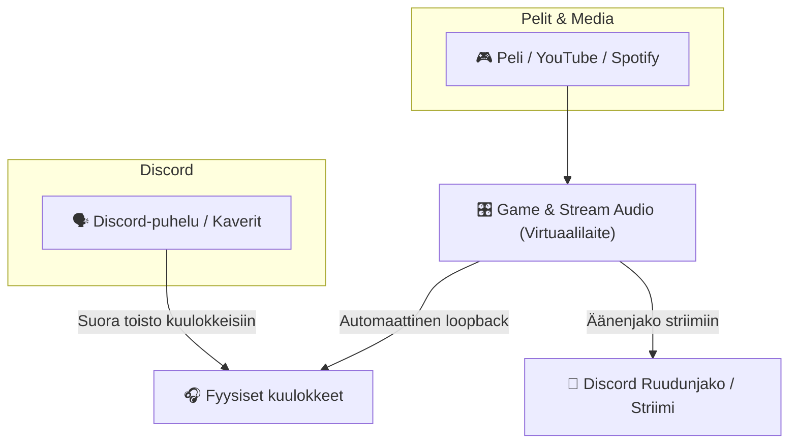

# 🎧 PipeWire Split Audio -opas: Ruudunjako ilman puhelukaikua

Tämä opas neuvoo, miten jaat pelin, musiikin ja järjestelmän äänet puhtaasti Discordissa tai Vesktopissa ilman, että Discordin oma äänipuhelu tai kaveriesi puhe vuotaa takaisin striimiin.

---

## 🛑 Miksi ongelma syntyy oletuksena?

Perusasetuksilla Linuxissa kaikki sovellukset (peli, selain ja Discord-puhelu) toistavat ääntä samaan oletusäänilaitteeseen (kuulokkeet / `Default Sink`).

Kun käynnistät ruudunjaon ja valitset äänten jaon, Discord tai Vesktop kaappaa kyseisen oletuslaitteen miksauksen (`Monitor of Default Sink`). Tällöin striimiin päätyvät **kaikki tietokoneen äänet** – mukaan lukien kaveriesi oma puhe puhelusta, mikä aiheuttaa häiritsevän kaiun.

---

## 💡 Ratkaisu: Split Audio (Dual Sink)

Ratkaisuna on erottaa puheluäänet ja peliäänet kahdelle eri äänikanavalle:



1. Luodaan PipeWireen virtuaalinen äänilaite: **`Game & Stream Audio`**.
2. Kaikki mitä toistetaan `Game & Stream Audio` -laitteeseen, kuuluu automaattisesti omissa kuulokkeissasi (PipeWiren sisäinen nollaviiveinen loopback).
3. **Discord-puhelun ulostulo ohjataan suoraan fyysisiin kuulokkeisiisi** (ohittaen virtuaalilaitteen).
4. Kun striimaat, jaat Discordille `Game & Stream Audio` -kanavan.
5. **Tulos:** Kaverisi kuulevat pelin ja musiikin täydellisellä laadulla, mutta eivät koskaan itseään tai Discord-puhelua!

---

## 🚀 Käyttöönotto (Askel askeleelta)

Repositorion mukana tulee valmis konfiguraatiotiedosto:
[`.config/pipewire/pipewire.conf.d/10-stream-sink.conf`](../.config/pipewire/pipewire.conf.d/10-stream-sink.conf)

### 1. Ota virtuaalilaite käyttöön

Jos asensit järjestelmän tämän repositorion kautta, tiedosto on jo paikallaan. Voit aktivoida sen heti ajamalla terminaalissa:
```bash
systemctl --user restart pipewire pipewire-pulse wireplumber
```
*(Tai kirjautumalla kerran ulos ja takaisin sisään.)*

Tarkista että uusi äänilaite näkyy:
```bash
pactl list sinks short | grep stream_sink
```

---

### 2. Säädä Discordin / Vesktopin puheluasetukset

Avaa Discord tai Vesktop:
1. Mene **Käyttäjäasetukset (Ratas) → Ääni ja video (Voice & Video)**.
2. Etsi kohta **Ulostulolaite (Output Device)**.
3. **TÄRKEÄÄ:** Vaihda asetus pois kohdasta *Oletus (Default)*. Valitse suoraan omat **fyysiset kuulokkeesi** (esim. *USB Audio DAC*, *Realtek Headphones* tms.).
4. Tämän jälkeen Discordin puheluäänet eivät koskaan päädy virtuaalikanavalle.

---

### 3. Aseta virtuaalikanava pelien ja järjestelmän oletukseksi

Avaa KDE Plasman ääniasetukset (tai tehtäväpalkin ääni-ikoni):
1. Aseta **Oletusäänilaitteeksi (Default Playback Device)**: **`Game & Stream Audio`**.
2. Nyt kaikki pelit, YouTube-videot ja musiikki toistuvat virtuaalilaitteen kautta kuulokkeisiisi.
3. Voit säätää äänenvoimakkuutta normaalisti kuten ennenkin.

---

### 4. Ruudunjako ja äänten jakaminen

Kun jaat ruutua Discordissa tai Vesktopissa:
* Valitse ruudunjaon äänilähteeksi **`Game & Stream Audio`** (tai sovelluskohtainen jako).
* Voit pelata ja puhua täysin vapaasti – puheluäänet pysyvät 100 % eristettyinä striimistä.

---

## 🎛️ Visuaalinen tarkistus `qpwgraph`:lla

Järjestelmään on asennettu kätevä `qpwgraph`-työkalu:
```bash
qpwgraph &
```
1. Avaa `qpwgraph`, niin näet kaikki tietokoneesi äänisolmut ja niiden väliset vihreät kytkentälangat.
2. Voit tarkistaa silmämääräisesti:
   - Pelin viivat menevät `stream_sink` -palikkaan ja kuulokkeisiisi.
   - Discordin viivat menevät **vain** kuulokkeisiisi.
   - Jos jokin ohjelma toistaa väärään paikkaan, voit hiirellä vetää uuden langan tai katkaista vanhan lennossa! PipeWire muistaa tekemäsi kytkennät.
